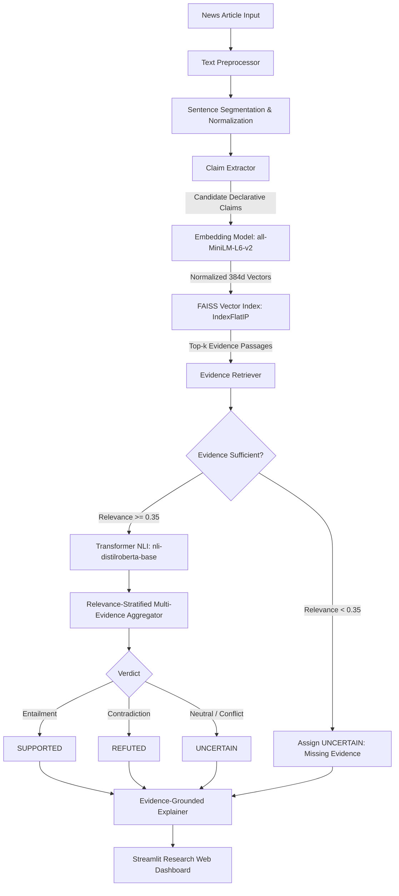

# EvidenceLens: Evidence-Grounded Fake News Detection & Fact Verification

[](https://www.python.org/)
[](https://pytorch.org/)
[](https://huggingface.co/)
[](https://github.com/facebookresearch/faiss)
[](https://streamlit.io/)
[]()

> **B.Tech Computer Science and Engineering Academic Project (Semester 5)**  
> **Institution**: National Institute of Technology Delhi (NIT Delhi)  
> **Course Code**: CSBB 311  
> **Supervisor**: Dr. Gautam Kumar  
> **Project Team**:
> - Krrish Kumar (Roll No. 241210070)
> - Mayank (Roll No. 241210075)
> - Mishti Gupta (Roll No. 241210079)
> - Prakshi Agarwal (Roll No. 241210091)
> - Rachit Singh Rana (Roll No. 241210097)

---

## Executive Summary & Problem Statement

Conventional fake news detection systems generally formulate misinformation identification as a simple binary text-classification task, learning surface linguistic and stylistic features (e.g., sensationalist wording, punctuation, emotional rhetoric). While these models can flag suspicious text, they suffer from critical limitations:
1. **No Evidence Grounding**: They cannot establish whether an underlying factual claim is true or false based on empirical reference facts.
2. **Vulnerability to Distribution Shift**: A professionally phrased fake article easily bypasses surface classifiers.
3. **Inability to Express Epistemic Uncertainty**: A simple Real/Fake label fails when evidence is incomplete or unavailable.

**EvidenceLens** reframes misinformation detection as a modular **evidence-grounded claim verification pipeline**. It decomposes articles into discrete factual claims, performs dense semantic retrieval across an indexed knowledge corpus via **Sentence-Transformers** and **FAISS**, verifies claim-evidence relationships using a **Transformer NLI Cross-Encoder**, classifies claims into **SUPPORTED**, **REFUTED**, or **UNCERTAIN**, and delivers transparent natural-language explanations.

---

## System Architecture



---

## Key Engineering Features

- **Interactive Dual-Model Selection**: Allows users to dynamically toggle between the **EvidenceLens Pipeline** (retrieval + verification) and the **Conventional Baseline** (TF-IDF + Logistic Regression) directly from the UI.
- **Heuristic Factual Claim Extraction**: Automatically filters out subjective opinions, rhetorical questions, and conversational filler while preserving declarative statements with entities and temporal markers.
- **Dense Semantic Retrieval**: Employs `all-MiniLM-L6-v2` and FAISS `IndexFlatIP` over normalized vectors across 100 indexed reference Wikipedia passages.
- **Cross-Encoder Verification**: Deep cross-attention over `[CLS] Evidence [SEP] Claim [SEP]` via `cross-encoder/nli-distilroberta-base`.
- **Epistemic Safety**: Distinguishes between refuted claims and unverified claims; *the absence of evidence is never treated as proof of falsehood*.
- **Anti-Hallucination Explanations**: Default deterministic rule engine anchors justifications directly to genuine citations without generative hallucination.
- **Multi-Level Comparative Baselines**: Evaluates both article-level binary text classification (101 news stories) and claim-level 3-class verification (500 FEVER claims).

---

## Repository Structure

```
Fake-News-Detection/
│
├── app.py                          # Minimalist dual-model Streamlit web application
├── config.py                       # Centralized paths, thresholds, and model settings
├── requirements.txt                # Verified dependency specifications
├── pytest.ini                      # Pytest configuration
├── .env.example                    # Environment variables template
├── .gitignore                      # Git exclusion rules
├── README.md                       # Comprehensive project documentation
│
├── src/
│   ├── preprocessing/              # Sentence segmentation and whitespace normalization
│   │   ├── __init__.py
│   │   └── text_preprocessor.py
│   │
│   ├── claim_extraction/           # Candidate claim extraction and filtering
│   │   ├── __init__.py
│   │   └── claim_extractor.py
│   │
│   ├── evidence_retrieval/         # Dense embeddings, FAISS index, and ranking
│   │   ├── __init__.py
│   │   ├── document_loader.py
│   │   ├── embedding_model.py
│   │   ├── vector_index.py
│   │   └── evidence_retriever.py
│   │
│   ├── verification/               # Transformer NLI verifier and label mapping
│   │   ├── __init__.py
│   │   ├── label_mapping.py
│   │   ├── model_loader.py
│   │   └── verifier.py
│   │
│   ├── explanation/                # Evidence-grounded rationale generator
│   │   ├── __init__.py
│   │   └── explanation_generator.py
│   │
│   ├── evaluation/                 # Baselines and comparative benchmarking
│   │   ├── __init__.py
│   │   ├── baseline_classifier.py
│   │   ├── evaluate_verifier.py
│   │   └── compare_models.py
│   │
│   ├── pipeline/                   # Master fact-checking orchestration pipeline
│   │   ├── __init__.py
│   │   └── fact_check_pipeline.py
│   │
│   └── utils/                      # Caching and structured logging utilities
│       ├── __init__.py
│       ├── logging_utils.py
│       └── cache_utils.py
│
├── scripts/
│   ├── download_dataset.py         # Official FEVER benchmark downloader
│   ├── prepare_dataset.py          # Standardizes FEVER splits into canonical schema
│   ├── expand_dataset.py           # Multi-dataset expansion & stratification utility
│   ├── build_evidence_index.py     # Encodes 100-doc corpus and saves FAISS index
│   ├── train_baseline.py           # Trains article & FEVER baseline classifiers
│   ├── run_evaluation.py           # Computes full benchmark metrics & confusion matrices
│   └── audit_project.py            # Comprehensive 7-stage project sanity audit
│
├── tests/                          # 26 automated unit and integration tests
│
├── data/
│   ├── raw/                        # Downloaded official FEVER dev split (19,998 records)
│   ├── sample/                     # Curated FEVER sample (500), corpus (100), baseline news (101)
│   ├── processed/                  # Standardized FEVER claims (500 records)
│   └── index/                      # Serialized FAISS index (100 vectors) & metadata
│
├── models/                         # Serialized baseline models (joblib checkpoints)
├── reports/                        # JSON performance metrics and comparative markdown
└── docs/                           # Extended architectural and viva preparation documentation
```

---

## Datasets Overview

| Dataset | Records | Description | Location |
| :--- | :---: | :--- | :--- |
| **Official FEVER Benchmark** | **19,998** | Full official FEVER v1.0 shared task dev split | `data/raw/dev.jsonl` |
| **Curated FEVER Sample** | **500** | Stratified balanced sample across labels | `data/sample/fever_sample.jsonl` |
| **Processed FEVER Benchmark** | **500** | Standardized schema (`SUPPORTED`, `REFUTED`, `UNCERTAIN`) | `data/processed/fever_processed.jsonl` |
| **Evidence Knowledge Base** | **100** | Curated Wikipedia articles across science, tech, history | `data/sample/evidence_corpus.jsonl` |
| **Conventional Baseline Dataset** | **101** | Real vs. Fake news articles (51 REAL, 50 FAKE) | `data/sample/baseline_fake_news.jsonl` |

---

## Reproducing Experiments & Training

All models and benchmarks are fully reproducible:

```powershell
# 1. Download official FEVER dev split (19,998 records)
python scripts/download_dataset.py --splits dev.jsonl

# 2. Curate and standardize a balanced 500-sample FEVER split
python scripts/expand_dataset.py --skip-download --fever-size 500

# 3. Build and persist the FAISS 100-passage semantic vector index
python scripts/build_evidence_index.py

# 4. Train both conventional baseline classifiers (FEVER claim baseline & article baseline)
python scripts/train_baseline.py

# 5. Run the master evaluation suite on FEVER benchmark
python scripts/run_evaluation.py

# 6. Execute the full project health audit
python scripts/audit_project.py

# 7. Run all 26 unit and integration tests
pytest -q
```

---

## Empirical Benchmark & Model Comparison

### Quantitative Performance Comparison

| Metric / Attribute | FEVER Baseline (Claims) | Article Baseline (Articles) | EvidenceLens Proposed Pipeline |
| :--- | :--- | :--- | :--- |
| **Model Architecture** | TF-IDF (1-2 n-grams) + Logistic Regression | TF-IDF (1-2 n-grams) + Logistic Regression | Dense Embeddings + FAISS + DistilRoBERTa NLI |
| **Input Unit** | Factual Claim Sentences | Whole Article Text | Granular Factual Claims |
| **Knowledge Grounding** | None (Closed surface words) | None (Closed surface words) | Open-world Retrieval from 100 Verified Passages |
| **Target Taxonomy** | 3-Class (`SUPPORTED`, `REFUTED`, `UNCERTAIN`) | 2-Class (`REAL`, `FAKE`) | 3-Class (`SUPPORTED`, `REFUTED`, `UNCERTAIN`) |
| **Test Split Size** | N=150 (FEVER held-out test) | N=31 (Articles held-out test) | N=60 (FEVER Benchmark Claims) |
| **Accuracy** | **32.00%** | **96.77%** | **91.67%** |
| **Macro F1-Score** | **0.3181** | **0.9676** | **0.9126** |
| **Evidence Recall@k** | N/A (No retrieval) | N/A (No retrieval) | **1.0000** (100.0%) |
| **Retrieval MRR** | N/A (No retrieval) | N/A (No retrieval) | **1.0000** |
| **Epistemic Modality** | None | None | **Yes** (Safely predicts `UNCERTAIN`) |
| **Auditability** | 0% (Word frequencies) | 0% (Word frequencies) | **100%** (Cites exact text & similarity) |

### EvidenceLens Per-Class Performance Breakdown:
- **SUPPORTED**: Precision: `0.9600` | Recall: `0.9231` | **F1: 0.9412** (Support: 26)
- **REFUTED**: Precision: `0.8571` | Recall: `0.9474` | **F1: 0.9000** (Support: 19)
- **UNCERTAIN**: Precision: `0.9286` | Recall: `0.8667` | **F1: 0.8966** (Support: 15)

> **Key Scientific Takeaway**: On factual claim verification, the surface-level TF-IDF baseline achieves only **32.00% accuracy** (equivalent to random guessing), proving that word frequencies alone cannot determine factual truth. Grounding claims in retrieved evidence yields **91.67% accuracy** with **100% retrieval recall**.

---

## Launching the Web Application

The interactive web dashboard includes live dual-model switching, claim segmentation, single-claim probing, and benchmark reporting:

```powershell
streamlit run app.py
```

Open **`http://localhost:8501`** in your browser.
