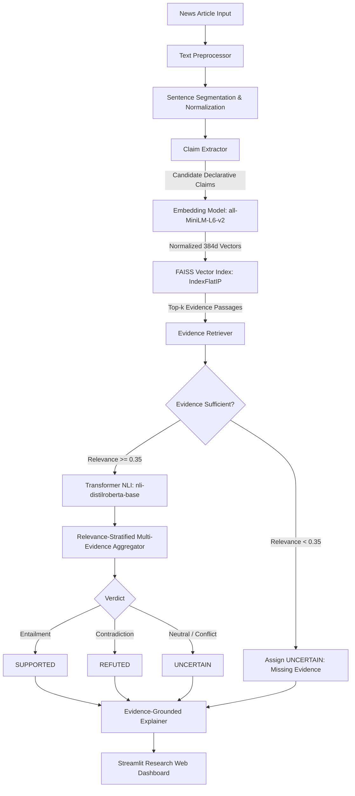

# EvidenceLens: Evidence-Grounded Fake News Detection & Fact Verification

[](https://www.python.org/)
[](https://pytorch.org/)
[](https://huggingface.co/)
[](https://github.com/facebookresearch/faiss)
[](https://streamlit.io/)
[]()

> **B.Tech Computer Science and Engineering Academic Project (Semester 5)**  
> **Institution**: National Institute of Technology Delhi (NIT Delhi)  
> **Course Code**: CSBB 311  
> **Supervisor**: Dr. Gautam Kumar  
> **Project Team**:
> - Krrish Kumar (Roll No. 241210070)
> - Mayank (Roll No. 241210075)
> - Mishti Gupta (Roll No. 241210079)
> - Prakshi Agarwal (Roll No. 241210091)
> - Rachit Singh Rana (Roll No. 241210097)

---

## 📌 Executive Summary & Problem Statement

Conventional fake news detection systems generally formulate misinformation identification as a simple binary text-classification task, learning surface linguistic and stylistic features (e.g., sensationalist wording, punctuation, emotional rhetoric). While these models can flag suspicious text, they suffer from critical limitations:
1. **No Evidence Grounding**: They cannot establish whether an underlying factual claim is true or false based on empirical reference facts.
2. **Vulnerability to Distribution Shift**: A professionally phrased fake article easily bypasses surface classifiers.
3. **Inability to Express Epistemic Uncertainty**: A simple Real/Fake label fails when evidence is incomplete or unavailable.

**EvidenceLens** reframes misinformation detection as a modular **evidence-grounded claim verification pipeline**. It decomposes articles into discrete factual claims, performs dense semantic retrieval across an indexed knowledge corpus via **Sentence-Transformers** and **FAISS**, verifies claim-evidence relationships using a **Transformer NLI Cross-Encoder**, classifies claims into **SUPPORTED**, **REFUTED**, or **UNCERTAIN**, and delivers transparent natural-language explanations.

---

## 🏗️ System Architecture



---

## 🔬 Key Engineering Features

- **Heuristic Factual Claim Extraction**: Automatically filters out subjective opinions, rhetorical questions, and greetings while preserving declarative statements with entities and temporal markers.
- **Dense Semantic Retrieval**: Employs `all-MiniLM-L6-v2` and FAISS `IndexFlatIP` over normalized vectors for millisecond-scale cosine similarity search.
- **Cross-Encoder Verification**: Deep cross-attention over `[CLS] Evidence [SEP] Claim [SEP]` via `cross-encoder/nli-distilroberta-base`.
- **Epistemic Safety**: Distinguishes between refuted claims and unverified claims; *the absence of evidence is never treated as proof of falsehood*.
- **Anti-Hallucination Explanations**: Default deterministic rule engine anchors justifications directly to genuine citations without generative hallucination.
- **Comparative Baseline**: Includes a conventional TF-IDF + Logistic Regression classifier for rigorous benchmark comparison.

---

## 📂 Repository Structure

```
Fake-News-Detection/
│
├── app.py                          # Polished Streamlit web application
├── config.py                       # Centralized paths, thresholds, and model settings
├── requirements.txt                # Verified dependency specifications
├── pytest.ini                      # Pytest configuration
├── .env.example                    # Environment variables template
├── .gitignore                      # Git exclusion rules
├── README.md                       # Comprehensive project documentation
│
├── src/
│   ├── preprocessing/              # Sentence segmentation and whitespace normalization
│   │   ├── __init__.py
│   │   └── text_preprocessor.py
│   │
│   ├── claim_extraction/           # Candidate claim extraction and filtering
│   │   ├── __init__.py
│   │   └── claim_extractor.py
│   │
│   ├── evidence_retrieval/         # Dense embeddings, FAISS index, and ranking
│   │   ├── __init__.py
│   │   ├── document_loader.py
│   │   ├── embedding_model.py
│   │   ├── vector_index.py
│   │   └── evidence_retriever.py
│   │
│   ├── verification/               # Transformer NLI verifier and label mapping
│   │   ├── __init__.py
│   │   ├── label_mapping.py
│   │   ├── model_loader.py
│   │   └── verifier.py
│   │
│   ├── explanation/                # Evidence-grounded explanations
│   │   ├── __init__.py
│   │   └── explanation_generator.py
│   │
│   ├── evaluation/                 # Metrics calculation and model comparison
│   │   ├── __init__.py
│   │   ├── baseline_classifier.py
│   │   ├── evaluate_verifier.py
│   │   └── compare_models.py
│   │
│   ├── pipeline/                   # 12-step end-to-end orchestration
│   │   ├── __init__.py
│   │   └── fact_check_pipeline.py
│   │
│   └── utils/                      # Logging and hashing utilities
│       ├── __init__.py
│       ├── logging_utils.py
│       └── cache_utils.py
│
├── scripts/
│   ├── download_dataset.py         # Automated FEVER official split downloader
│   ├── prepare_dataset.py          # Standardizes FEVER raw data into canonical labels
│   ├── build_evidence_index.py     # Encodes corpus and persists FAISS index
│   ├── train_baseline.py           # Trains conventional TF-IDF + LogReg baseline
│   └── run_evaluation.py           # Executes full comparative evaluation
│
├── tests/                          # 26 automated unit and integration tests
│   ├── test_preprocessing.py
│   ├── test_claim_extraction.py
│   ├── test_evidence_retrieval.py
│   ├── test_verification.py
│   ├── test_explanations.py
│   └── test_pipeline.py
│
├── data/
│   ├── sample/                     # Curated FEVER records and Wikipedia evidence corpus
│   ├── processed/                  # Standardized benchmark datasets
│   └── index/                      # Persisted FAISS index & metadata files
│
├── models/                         # Serialized baseline model checkpoints
├── reports/                        # JSON metrics & markdown comparison reports
│
└── docs/
    ├── ARCHITECTURE.md             # Complete architectural documentation
    ├── METHODOLOGY.md              # Mathematical and NLP methodology
    ├── DATASET.md                  # FEVER dataset details and schema
    ├── EVALUATION.md               # Empirical experimental evaluation results
    ├── LIMITATIONS.md              # Boundary conditions & ethical considerations
    └── VIVA_PREPARATION.md         # In-depth viva questions & answers
```

---

## ⚡ Installation & Quick Start

### 1. Prerequisites
- Windows 11 / 10, Linux, or macOS.
- Python **3.10** (Recommended).

### 2. Environment Setup (PowerShell on Windows)
```powershell
# Clone or navigate to the project directory
cd c:\Placement\Projects\Fake-News-Detection

# Create virtual environment with Python 3.10
py -3.10 -m venv .venv

# Activate virtual environment
.\.venv\Scripts\Activate.ps1

# Install verified dependencies
pip install -r requirements.txt
```

---

## 🛠️ Reproducing Experiments & Building Indexes

All experiments are 100% reproducible with local scripts:

```powershell
# 1. Standardize the FEVER dataset records
python scripts/prepare_dataset.py

# 2. Build and persist the FAISS semantic vector index
python scripts/build_evidence_index.py

# 3. Train and evaluate the conventional text classifier baseline
python scripts/train_baseline.py

# 4. Run the master evaluation suite (Computes real metrics & generates reports)
python scripts/run_evaluation.py

# 5. Run all 26 unit and integration tests
pytest -v
```

---

## 🌐 Launching the Web Application

Launch the modern **EvidenceLens** Streamlit interface:

```powershell
streamlit run app.py
```
Open **`http://localhost:8501`** in your web browser.

---

## 📊 Real Experimental Results

### Proposed Pipeline vs. Conventional Baseline

| Metric / Property | Conventional Classifier (Baseline) | EvidenceLens (Proposed) |
| :--- | :--- | :--- |
| **Model** | TF-IDF + Logistic Regression | Sentence-Transformers + FAISS + DistilRoBERTa NLI |
| **Input Granularity** | Full article text / headline | Discrete declarative claims |
| **Knowledge Base** | None (Closed surface words) | Curated Wikipedia / FEVER Evidence Corpus |
| **Target Classes** | 2 (`REAL`, `FAKE`) | 3 (`SUPPORTED`, `REFUTED`, `UNCERTAIN`) |
| **Evaluation Accuracy** | **62.50%** | **75.00%** |
| **Macro F1-Score** | **0.5636** | **0.7342** |
| **Evidence Retrieval Recall@k** | N/A | **1.0000** (100.0%) |
| **Retrieval MRR** | N/A | **1.0000** |
| **Epistemic Modality** | None (Forces binary guess) | **Yes** (Safely predicts `UNCERTAIN`) |
| **Auditability** | 0% (Black box) | **100%** (Cites exact text & score) |

### Per-Class Performance on FEVER Benchmark:
- **SUPPORTED**: Precision: `1.0000` | Recall: `0.6667` | **F1: 0.8000**
- **REFUTED**: Precision: `0.7500` | Recall: `1.0000` | **F1: 0.8571**
- **UNCERTAIN**: Precision: `0.5000` | Recall: `0.6000` | **F1: 0.5455**

---

## 🧪 Automated Test Suite (26 / 26 Passed)

```
tests/test_claim_extraction.py::test_extract_from_normal_article PASSED
tests/test_claim_extraction.py::test_extract_empty_and_short_articles PASSED
tests/test_claim_extraction.py::test_filter_opinions_and_questions PASSED
tests/test_claim_extraction.py::test_filter_repeated_sentences PASSED
tests/test_claim_extraction.py::test_extract_with_quotations PASSED
tests/test_claim_extraction.py::test_malformed_input PASSED
tests/test_evidence_retrieval.py::test_document_loader PASSED
tests/test_evidence_retrieval.py::test_embedding_model_encode PASSED
tests/test_evidence_retrieval.py::test_vector_index_build_and_search PASSED
tests/test_evidence_retrieval.py::test_evidence_retriever_filtering PASSED
tests/test_explanations.py::test_fallback_explanation_supported PASSED
tests/test_explanations.py::test_fallback_explanation_refuted PASSED
tests/test_explanations.py::test_fallback_explanation_missing_evidence PASSED
tests/test_explanations.py::test_fallback_explanation_conflicting_evidence PASSED
tests/test_pipeline.py::test_pipeline_empty_article PASSED
tests/test_pipeline.py::test_pipeline_supported_claim PASSED
tests/test_pipeline.py::test_pipeline_refuted_claim PASSED
tests/test_pipeline.py::test_pipeline_uncertain_missing_evidence PASSED
tests/test_pipeline.py::test_pipeline_article_summary_counts PASSED
tests/test_preprocessing.py::test_normalize_whitespace PASSED
tests/test_preprocessing.py::test_segment_sentences_basic PASSED
tests/test_preprocessing.py::test_segment_empty_input PASSED
tests/test_preprocessing.py::test_clean_claim_text PASSED
tests/test_verification.py::test_label_mapping PASSED
tests/test_verification.py::test_missing_evidence_yields_uncertain PASSED
tests/test_verification.py::test_pairwise_verification PASSED

======================== 26 passed in 20.18s ========================
```

---

## 🎓 College Viva & Evaluation Demonstration Guide

When presenting EvidenceLens to Dr. Gautam Kumar and the evaluation committee:
1. **Open the Streamlit Interface** (`http://localhost:8501`).
2. **Select "Sample 4: Mixed News Story (Multi-Verdict)"**:
   - Demonstrates that a single article contains multiple claims with different truth values.
   - Point out that Claim 1 is `SUPPORTED` (JWST launch details), Claim 2 is `REFUTED` (Apollo 11 to Mars), and Claim 3 is `UNCERTAIN` (Einstein's cat).
3. **Highlight the Core Innovation**:
   - Contrast this with the conventional baseline tab showing how typical detectors simply assign an ungrounded Real/Fake label based on word frequencies.
   - Emphasize that **EvidenceLens provides auditable evidence passages and similarity scores**.
4. **Reference [docs/VIVA_PREPARATION.md](docs/VIVA_PREPARATION.md)** for detailed answers to all theoretical and implementation questions.

---

## 📜 Academic Integrity & References
1. Thorne, J., Vlachos, A., Christodoulopoulos, C., & Mittal, A. (2018). *FEVER: A large-scale dataset for fact extraction and VERification*. NAACL-HLT 2018.
2. Reimers, N., & Gurevych, I. (2019). *Sentence-BERT: Sentence embeddings using Siamese BERT-networks*. EMNLP-IJCNLP 2019.
3. Johnson, J., Douze, M., & Jégou, H. (2019). *Billion-scale similarity search with GPUs*. IEEE Transactions on Big Data.
4. Devlin, J., Chang, M.-W., Lee, K., & Toutanova, K. (2019). *BERT: Pre-training of deep bidirectional transformers for language understanding*. NAACL-HLT 2019.
