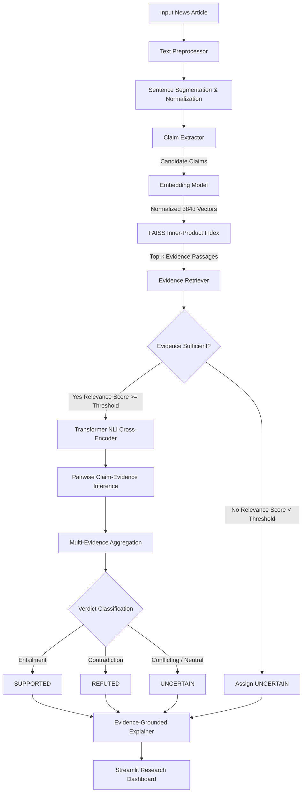

# System Architecture: EvidenceLens

## 1. Overview
**EvidenceLens** is a modular, evidence-grounded fact verification and misinformation detection platform developed as a B.Tech Computer Science and Engineering project at the **National Institute of Technology Delhi**.

Unlike conventional black-box text classifiers that learn stylistic proxies (such as sensationalist punctuation or biased vocabulary), EvidenceLens decomposes complex news content into discrete claims, retrieves empirical evidence from an indexed knowledge corpus, evaluates claim-evidence relationships via deep transformer representations, and produces auditable, evidence-backed explanations.

---

## 2. Pipeline Flow Diagram



---

## 3. Detailed Component Breakdown

### 3.1 Preprocessing Module (`src/preprocessing/`)
- **`text_preprocessor.py`**:
  - Validates article string integrity and enforces unicode whitespace normalization.
  - Implements an abbreviation-resilient sentence segmenter protecting common acronyms, titles (`Dr.`, `Prof.`, `U.S.`), and temporal expressions from improper splitting.
  - Cleans quotes and extraneous formatting while strictly preserving lexical semantics.

### 3.2 Claim Extraction Module (`src/claim_extraction/`)
- **`claim_extractor.py`**:
  - Filters out subjective opinions, rhetorical remarks, conversational greetings, and question sentences.
  - Retains declarative factual statements containing entities, temporal indicators, numeric quantities, and assertion verbs.
  - Assigns unique claim identifiers (`claim_001`), original spans, and heuristic confidence scores.

### 3.3 Semantic Evidence Retrieval (`src/evidence_retrieval/`)
- **`document_loader.py`**: Ingests and validates knowledge documents from JSONL sources, preserving passage identifiers, source titles, and genuine canonical URLs.
- **`embedding_model.py`**: Wraps `sentence-transformers/all-MiniLM-L6-v2` with batch inference, automatic GPU/CPU device detection, and unit L2 vector normalization.
- **`vector_index.py`**: Houses a high-efficiency `FAISS` vector index (`IndexFlatIP`). Inner product on unit-normalized vectors calculates exact cosine similarity.
- **`evidence_retriever.py`**: Executes dense semantic queries for each candidate claim, suppresses duplicates, applies a minimum relevance threshold (`0.35`), and ranks retrieved passages.

### 3.4 Claim Verification Module (`src/verification/`)
- **`model_loader.py`**: Manages cached instantiations of Hugging Face transformers.
- **`label_mapping.py`**: Resolves discrepancies across benchmark naming conventions into the canonical three-state taxonomy:
  - `SUPPORTED` (Entailment / Supports)
  - `REFUTED` (Contradiction / Refutes)
  - `UNCERTAIN` (Neutral / Not Enough Info / Insufficient Evidence)
- **`verifier.py`**: Evaluates `(evidence_text, claim_text)` pairs using a pretrained `cross-encoder/nli-distilroberta-base`. Employs relevance-stratified multi-evidence aggregation.

### 3.5 Grounded Explanation Module (`src/explanation/`)
- **`explanation_generator.py`**:
  - **Deterministic Grounded Fallback**: Automatically constructs precise, fact-anchored justifications citing the specific evidence passage, source title, and relevance score without hallucinations.
  - **Optional LLM Integration**: Supports OpenAI (`gpt-4o-mini`), Groq (`llama-3.1-8b-instant`), or Gemini via API keys, guided by anti-hallucination system instructions that forbid altering verification verdicts.

### 3.6 Benchmark & Evaluation Module (`src/evaluation/`)
- **`baseline_classifier.py`**: Implements a traditional TF-IDF + Logistic Regression text classifier on article-level real/fake news.
- **`evaluate_verifier.py`**: Computes classification (Accuracy, Precision, Recall, Macro-F1, Confusion Matrix) and retrieval metrics (Recall@k, MRR) over the FEVER dataset.
- **`compare_models.py`**: Synthesizes comparative performance and methodological analysis into Markdown reports.

### 3.7 Orchestration Pipeline (`src/pipeline/`)
- **`fact_check_pipeline.py`**: Orchestrates the 12-step verification pipeline from input validation through article-level aggregation and JSON serialization.

---

## 4. Data Flow Specifications

### Claim Verification Output Schema:
```json
{
  "claim_id": "claim_001",
  "claim_text": "The James Webb Space Telescope conducts infrared astronomy.",
  "label": "SUPPORTED",
  "confidence": 0.8842,
  "retrieval_status": "evidence_found",
  "evidence": [
    {
      "passage_id": "doc_001",
      "title": "James Webb Space Telescope",
      "text": "The James Webb Space Telescope (JWST) is a space telescope specifically designed to conduct infrared astronomy...",
      "source_id": "wiki_jwst",
      "source_url": "https://en.wikipedia.org/wiki/James_Webb_Space_Telescope",
      "relevance_score": 0.8412,
      "rank": 1
    }
  ],
  "explanation": "The claim is SUPPORTED by verified knowledge. According to 'James Webb Space Telescope' (Relevance: 0.84): \"The James Webb Space Telescope (JWST) is a space telescope specifically designed to conduct infrared astronomy...\", which directly confirms the factual premise of the claim.",
  "explanation_provider": "Deterministic Grounded Engine (Rule-based)",
  "verification_metadata": {
    "model_name": "cross-encoder/nli-distilroberta-base",
    "device": "cpu",
    "conflict_detected": false
  }
}
```
